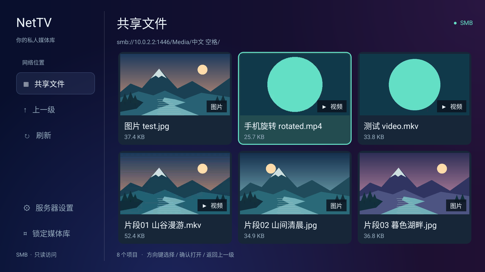
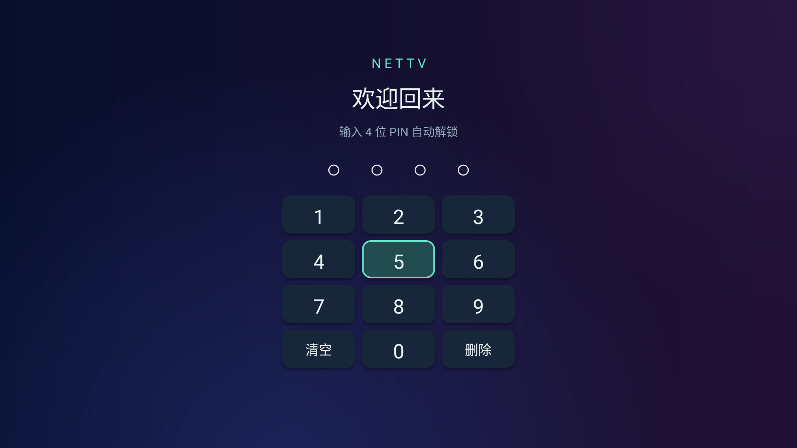
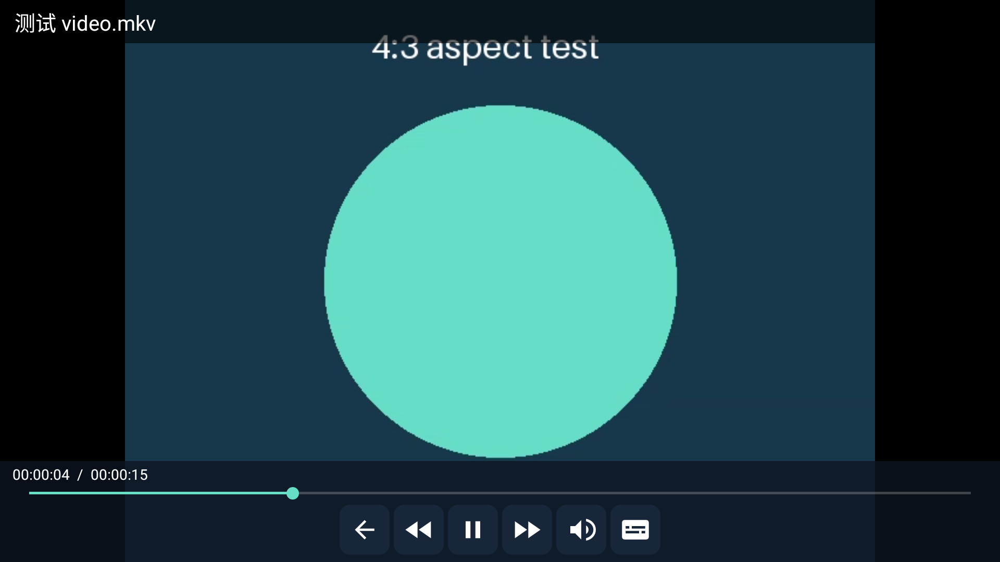

# NetTV 私人媒体库

适配 Android 9（API 28）及以上的电视应用，直接浏览 SMB 共享中的文件夹、视频和图片。原生 Java 界面，支持方向键、确认键和返回键，无需触屏。

[](https://github.com/coderhwz/nettv/actions/workflows/build.yml)
[](LICENSE)

[下载最新版本](https://github.com/coderhwz/nettv/releases/latest) · [反馈问题](https://github.com/coderhwz/nettv/issues)



## 安装与使用

从 [Releases](https://github.com/coderhwz/nettv/releases/latest) 下载：

| 安装包 | 适用设备 |
| --- | --- |
| [NetTV-1.3.5.apk](https://github.com/coderhwz/nettv/releases/download/v1.3.5/NetTV-1.3.5.apk) | 通用包，约 56 MiB，不确定系统架构时选它 |
| [NetTV-1.3.5-arm32.apk](https://github.com/coderhwz/nettv/releases/download/v1.3.5/NetTV-1.3.5-arm32.apk) | ARM 32 位系统 |
| [NetTV-1.3.5-arm64.apk](https://github.com/coderhwz/nettv/releases/download/v1.3.5/NetTV-1.3.5-arm64.apk) | ARM 64 位系统 |

同时提供 SHA256 校验文件。与已安装版本签名相同时，可直接覆盖安装并保留 PIN 与服务器配置。

1.3.5 增加目录遥控器滚动动画与图片左右滑动、淡入淡出动画，加载下一张时保留当前画面。图片读取复用同一个 SMB 文件句柄，常见图片的头部数据直接复用；超出 60 KiB 的大头部可在同一文件句柄上回到开头重新读取。读取缓冲调整为 60 KiB，避免超过当前 jCIFS 默认 SMB2 单次读取上限而拆出额外的小请求。

当前图片显示后只预取同目录下一张大图，不连续预取整个目录；切到下一张时复用正在读取的任务或已解码位图。换方向、退出图片、切换目录或锁定时取消无关任务。图片读取最多使用 2 个线程，让当前请求可以避开仍在结束的旧预取读取。大图仍只保存在最多 16 MiB 的内存缓存中，不写入磁盘；锁定、进入后台或切换服务器时清空。卡片缩略图仍仅为实际可见的卡片加载。

1.3.4 优化点开大图和左右切图：切换时取消旧的 SMB 图片读取，已查看的大图按电视实际分辨率等比缩放后保存在最多 16 MiB 的内存缓存中。切回已看过的图片可直接复用位图，不再次请求 SMB；锁定、进入后台或切换服务器时清空。只缓存实际打开过的图片，不预取相邻图片，不将完整图片写入磁盘。首次打开仍需读取服务器图片，耗时日志新增网络读取字节数、次数、耗时和大图缓存来源。

1.3.3 支持视频播放时用左右键直接快退/快进 10 秒，控制栏隐藏时按第一次就会定位并显示进度；连续按键继续定位。按上下键或确认键进入控制栏后，可用左右键选择播放、音轨、字幕等按钮；焦点在进度条时左右键仍用于定位。

1.3.2 改为居中的四位 PIN 数字键盘，不使用文本输入框；支持遥控器数字键或方向键选择数字，输入第四位后自动验证并打开主页，首次设置和修改需输入两次。缓存读取使用独立线程，新预览先显示再后台加密保存；缩略图固定为 640×360，减少编码和内存开销。最近 8 个目录在当前进程中保留列表快照，返回时先显示、再后台检查变化，目录未变化时保留卡片和预览任务。



1.3.1 将媒体播放控制改为矢量图标；图片默认全屏隐藏控制，按确认、上下键或点击画面显示图标，5 秒后隐藏。进入文件夹后，遥控器返回或侧栏“上一级”都会自动选中刚刚进入的文件夹，多层目录逐层恢复。

1.3.0 增加按可见卡片生成的加密缩略图缓存。图片和视频各使用 2 个后台线程，最多同时运行 4 个预览任务；重开目录优先复用已有缓存，不扫描整个目录生成封面。

1.2.2 增加由本机密钥加密保护的快速 PIN 校验，Android 9 电视盒子实测约 20–30 毫秒。旧版本升级后首次正确解锁仍需完成原有校验，之后自动使用快速校验，无需重设 PIN。此外，图片改为全屏显示、提高卡片预览清晰度，并修复带旋转信息的手机竖屏视频被拉伸的问题。

Gradle 原始构建产物在 `app/build/outputs/apk/debug/`：

- `app-universal-debug.apk`：通用电视安装包，包含 ARM 32 / 64 位。
- `app-armeabi-v7a-debug.apk`：ARM 32 位电视安装包。
- `app-arm64-v8a-debug.apk`：ARM 64 位安装包。64 位芯片的电视也可能运行 32 位系统，不确定时使用通用包。

这些是调试签名的可安装 APK，适合侧载，尚未配置正式发布签名。自行构建或 GitHub Actions 生成的包使用各自的调试密钥，签名可能与已安装版本不同，不能保证直接覆盖安装；卸载会清除 PIN、服务器配置和缓存。签名私钥不随源码发布。

1. 首次打开，设置并确认一个 4 位数字 PIN。
2. 输入共享地址，如 `smb://192.168.1.10/Movies/`，也可以指向共享中的子目录。支持 IP、主机名和自定义端口。
3. 填写 SMB 用户名、密码；域通常留空。用户名留空时以访客身份访问，服务器需要允许访客。
4. 点击“保存并连接”，连接成功后保存配置。方向键选择文件夹或文件，确认打开。
5. 返回键返回上一级并选中刚刚进入的文件夹。图片全屏等比显示，控制栏默认隐藏，左右键切换同目录图片；确认或上下键显示图标控制栏，返回键退出。应用切到后台或按“锁定”后需重新输入 PIN。

## 电视浏览布局

1.2.0 参考 [FileOne 官方电视版界面](https://fileone.app/) 的布局：左侧固定导航、深色渐变背景、右侧紧凑标题与路径栏、媒体卡片网格。NetTV 保留自己的名称、配色和功能，侧栏提供共享文件、上一级、刷新、服务器设置和锁定入口；底部显示项目数量与遥控器提示。

## 卡片预览

文件夹和媒体以卡片网格展示，列数随电视可用宽度调整。图片显示缩略图，视频通过 SMB 随机读取提取画面封面，卡片下方显示文件名和大小。方向键移动焦点、确认打开；返回浏览时保留选中位置。

只有实际出现在屏幕上的卡片才会请求预览，不会为整个目录预先生成；滚动后取消移出屏幕的排队任务，已开始读取的任务在后续读取时检查取消状态。图片和视频各使用 2 个后台线程，避免慢视频封面占满图片任务。

预览最多使用 8 MiB 内存缓存，并在应用私有目录 `cache/thumbnails/` 中保存最多 64 MiB 的加密磁盘缓存。缓存使用独立的 Android Keystore AES-GCM 密钥，每次写入使用随机 IV；PNG 缩略图只在内存中编码、解密，不产生明文临时文件。文件名使用摘要，不暴露原始路径。锁定时取消预览任务并清空内存缓存，磁盘缓存保留；超过容量后清理最久未使用的条目，系统也可能回收缓存目录。

缓存身份包含服务器、账号、文件路径、大小和修改时间；文件变化后重新生成，切换账号不会复用另一账号的条目。目录刷新保留仍有效的预览。磁盘只缓存缩略图，不缓存完整图片或视频；全屏大图和下一张预取使用上述有容量上限的内存缓存。

缓存读取与 SMB 生成分开排队：2 个缓存读取线程、图片和视频各 2 个生成线程，另用单独线程写入缓存。在 Android 9 Cmiot_Box 上复现了大块 GCM 数据校验失败，改为 4 KiB 分块加解密；实机大尺寸随机缩略图的加密、重开读取和像素一致性测试通过。旧缓存校验失败时仅对可见卡片重新生成。PNG 编码、加解密、图片解码在文件锁之外进行，文件读取和原子提交保留互斥保护。后台写入队列最多 16 项，满时跳过最早尚未写入的条目；不影响已显示的预览。

视频封面使用 Android 系统的缩略图解码能力，不支持提取画面的编码或网络读取失败时显示默认视频图标，实际播放仍使用 VLC。

图片预览按卡片裁切所需像素采样，避免先缩得过小再放大；视频封面也按源文件比例和旋转信息取图。图片查看时全屏显示。


## 播放器

内置 VideoLAN **LibVLC 3.7.7**，无需另外安装 VLC。支持 VLC 能解码的多种封装和编码，识别 MP4、MKV、AVI、MOV、WMV、FLV、TS、M2TS、MPEG、WebM、VOB、RM/RMVB 等视频扩展名；未识别的文件也可选择尝试播放。

- 直接通过 SMB 流式播放，不先下载完整视频。
- 按视频原始宽高比完整显示，空余区域留黑边，不拉伸或裁切画面。
- 读取有效视频轨道尺寸、像素比例和旋转方向，修正手机竖屏视频的显示比例。合成视频的模拟器截图见 [竖屏比例示例](docs/portrait-video-v1.2.2.png)。
- 暂停/播放、快进快退 10 秒、进度条定位。
- 选择文件中的音轨和内嵌字幕；没有做外挂字幕文件选择。
- 默认硬件解码；如出现花屏或黑屏，在服务器设置中启用软件解码。
- 播放时保持屏幕常亮，控制栏 5 秒后隐藏。左右键直接快退/快进 10 秒；上下键或确认键进入控制栏，再用方向键选择按钮。

播放控制使用返回、后退、播放/暂停、前进、音轨和字幕图标；按钮保留中文辅助说明，方便无障碍访问。



支持的封装不代表任意编码、损坏文件或任意码率都能播放。4K、HEVC、高码率视频的效果取决于电视性能和网络。ISO 可以尝试打开，不保证完整光盘菜单。图片使用系统解码器，支持 JPG、PNG、WebP、BMP 等；GIF 显示静态帧，HEIF/HEIC 取决于系统支持。图片采样到适合电视的尺寸后显示，不缓存完整文件到磁盘。

## 密码保护

- PIN 使用随机盐和 PBKDF2-HMAC-SHA256（120,000 次）派生后保存，不保存明文 PIN。
- 快速校验值由同一台设备的 Keystore AES-GCM 密钥加密保存；旧 PIN 首次成功验证后自动建立。原 PBKDF2 结果保留用于迁移和校验值损坏时恢复，错误次数限制仍然生效。密钥保护方式见 [Android Keystore 官方说明](https://developer.android.com/privacy-and-security/keystore)。
- 连续输错 5 次后暂停尝试 30 秒，重启应用不会清除这段限流。
- SMB 地址和账号密码通过 Android Keystore 的 AES-GCM 密钥加密保存；禁用应用备份。
- 禁止普通系统截图和最近任务缩略图捕获媒体界面。
- PIN 是应用访问锁，不会加密服务器上的视频，也不是 SMB 传输加密开关。拥有其他 SMB 客户端或能清除应用数据的人不受这个应用 PIN 限制。
- 已解锁后，可从服务器设置修改 PIN。忘记 PIN 需要在系统设置清除应用数据并重新配置。

目录浏览使用 jCIFS-ng，禁用 SMB1，允许 SMB2/3 协商。要求服务器提供兼容的文件访问服务；未验证强制 SMB3 传输加密、企业 Kerberos 登录或全部 NAS 型号。应用提供只读浏览与播放，没有删除、上传或修改服务器文件的功能。

## 耗时日志

系统日志标签为 `NetTV.Perf`，同时异步保存到应用私有目录 `files/performance.log`，单份 256 KiB、轮转保留一份旧日志，总量约 512 KiB。只记录阶段、毫秒耗时、数量、像素尺寸、错误类型及缩略图摘要前缀，不记录 PIN、账号密码、文件名或完整路径。

阶段包括 PIN 验证、服务器配置加载、目录排队/读取、列表布局、内存命中、磁盘读取/解密/解码、SMB 图片解码、视频随机读取/抽帧、预览显示、缓存编码/加密/提交、大图显示及视频启动。`preview_shown` 表示位图交给界面，不代表最终屏幕呈现；SMB 图片解码耗时包含网络读取和解码。`headerReused` 表示解码时能否直接复用头部缓冲；`image_prefetch ready/promoted` 分别表示下一张预取完成、预取任务被接续为当前图片加载。`readCalls` 是应用对 SMB 读取接口的调用次数，不等于网络数据包数。

```sh
adb logcat -s NetTV.Perf:I '*:S'
# 电视的 logcat 无法读取时，可读取当前调试签名安装的私有日志：
adb exec-out run-as com.hwz.nettv cat files/performance.log
adb exec-out run-as com.hwz.nettv cat files/performance.previous.log
```

## 构建

使用 JDK 17、Android SDK Platform 36、Build Tools 35。Gradle Wrapper 会下载 Gradle 8.11.1。最低运行版本为 Android 9；当前目标版本设为 API 34，面向电视侧载使用，未配置应用商店发布。

```sh
git clone https://github.com/coderhwz/nettv.git
cd nettv
# 安装 Android SDK Platform 36、Build Tools 35.0.0，使用 JDK 17。
# 在 local.properties 中设置 sdk.dir，或设置 ANDROID_HOME。
./gradlew assembleDebug testDebugUnitTest lintDebug
adb install -r app/build/outputs/apk/debug/app-universal-debug.apk
```

源码入口：`app/src/main/java/com/hwz/nettv/MainActivity.java`。播放器为 `VideoPlayer.java`，卡片缩略图加载为 `MediaThumbnails.java`，SMB 浏览为 `SmbBrowser.java`，本机密码保护为 `Vault.java`。

## 验证

- JVM 测试：PIN 长度/字符边界、正确密码验证、错误密码和不同盐拒绝，以及与旧版本密码派生结果兼容。
- 设备测试：URI 编码、加密凭据读写、PIN 错误限流。
- SMB 集成设备测试使用临时 Samba 共享，包含 `中文 空格/图片 test.jpg`、`中文 空格/片段02 山间清晨.jpg` 和 `中文 空格/测试 video.mkv`。视频为包含青绿色圆形的 4:3 合成片段。验证列目录、预览像素尺寸、全屏图片及左右切换、解锁到播放的界面流程、VLC 播放进度推进与拖动定位、圆形显示比例，以及后台重新锁定。

格式回归另通过 `imageFormatsFixture` 指定专用共享目录，内含 320×180 的 JPEG、PNG、WebP、GIF、BMP 和头部大于 60 KiB 的 JPEG，共 6 张合成图片。

默认不运行 SMB 集成测试；手动测试需提供上述合成文件和专用测试账号 `nettv` / `Test1234`，不能指向真实个人共享。设备测试会清空测试安装的应用配置。

```sh
./gradlew connectedDebugAndroidTest \
  -Pandroid.testInstrumentationRunnerArguments.smbUrl=smb://10.0.2.2:1446/Media/
```

1.3.0 验证包含 3 项 JVM 测试及 8 项模拟器设备测试；Lint 检查无错误，保留兼容性/国际化等提示。缓存测试覆盖加密持久化、随机 IV、篡改拒绝、容量清理、文件及账号变化失效，以及可见卡片加载和并行执行。40 个混合媒体文件的目录，仅浏览首屏和末屏时生成了 10 份缓存；新页面在错误 SMB 密码下仍能从磁盘恢复预览。其余设备测试覆盖图片、VLC 播放及定位、取消图片读取、PIN 与凭据保护。

1.3.1 通过 3 项 JVM 测试、Lint，以及 2 项相关设备流程测试：多层目录用返回键和侧栏逐层恢复焦点；图片图标控制唤出与切换；视频 6 个图标按钮及播放/暂停切换、解码与定位。

1.3.2 相关验证包括 3 项 JVM 测试、Lint，以及 14 项模拟器设备测试。新增测试验证四位 PIN 自动提交、错误重试和二次确认，缓存读取不等待被占满的网络线程、缓存写入阻塞时预览仍能显示，以及目录刷新阻塞时仍能恢复上级列表和焦点；新增大尺寸随机 PNG 缓存往返测试覆盖电视上的 GCM 兼容问题。40 个混合文件只浏览首尾时生成 10 份缓存；磁盘缓存重开测试不依赖有效 SMB 密码。

1.3.3 构建与 Lint 通过，新增 1 项 SMB 视频遥控器集成测试：控制栏隐藏时第一次按右键即快进、控制栏显示后左键仍可快退、显式进入按钮导航后仍能选择并触发快进图标。测试通过真实遥控器按键注入，检查 VLC 播放时间变化。

1.3.4 构建与 Lint 通过，3 项相关设备流程测试通过：大图按目标尺寸显示、取消后中止读取、两张已看大图在错误 SMB 密码下可左右切换且复用相同位图、未打开图片不预取、后台锁定后清空缓存，以及完整图片和视频播放流程。

1.3.5 构建与 Lint 通过，7 项相关模拟器设备测试通过：JPEG/PNG/WebP/GIF/BMP 解码和大头部 JPEG 回退、等比缩放与读取取消、仅下一张预取及任务复用、切图位移动画和透明度、内存缓存离线复用与锁定清空、目录遥控器滚动动画及嵌套目录返回焦点，以及完整图片/VLC 播放流程。模拟器日志中预取后的大图交给界面约 1–3 毫秒，此数据不代表真实电视的网络读取耗时。

设备验证使用 Android 14 Google TV ARM64 模拟器及 Android 9 ARM32 Cmiot_Box。真实电视已验证保存的 SMB 配置可读取图片、快速 PIN 校验，以及 4:3、原生竖屏和带旋转信息的手机竖屏合成视频在最终屏幕截图中保持比例。遥控器实体按键、各类编码和 4K 性能仍需实机验收。

## 第三方组件

NetTV 自有源码采用 [MIT License](LICENSE)。第三方组件保留各自许可证，见 [THIRD_PARTY_NOTICES.md](THIRD_PARTY_NOTICES.md) 和 [licenses](licenses)。
